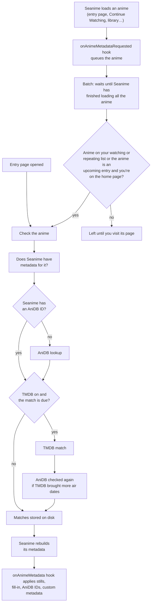
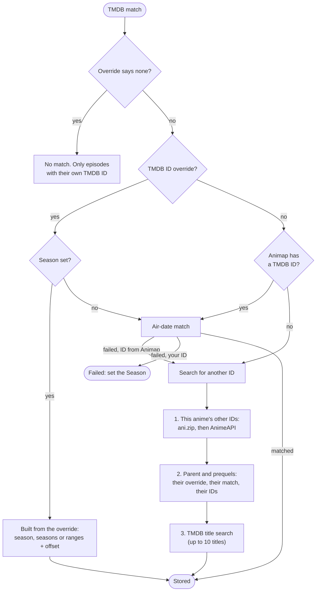
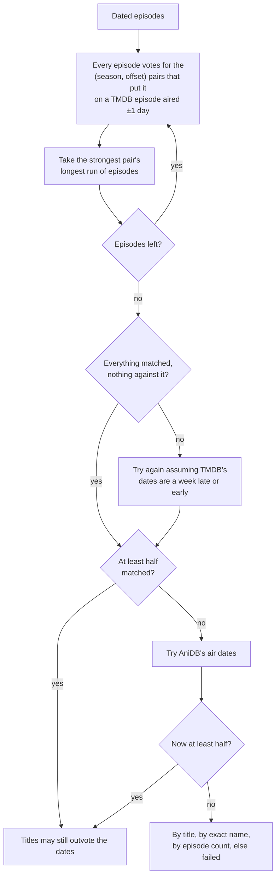
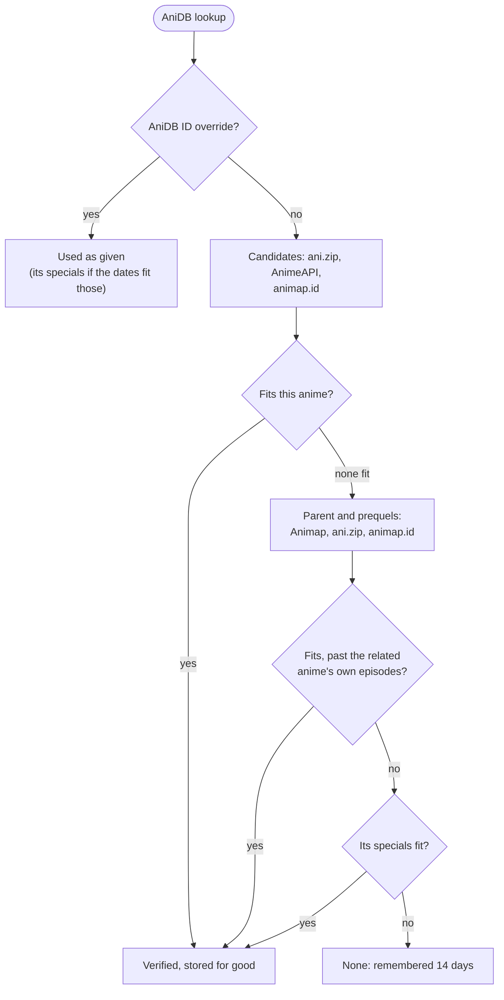

# Missing Metadata Fix

A [Seanime](https://seanime.app) plugin built on top of nnotwens [Custom Episode Metadata](https://github.com/nnotwen/n-seanime-extensions/tree/master/plugins/Custom%20Episode%20Metadata) that fills the gaps in Seanime's episode metadata. It matches every anime you
watch on [TMDB](https://www.themoviedb.org) and [AniDB](https://anidb.net) and uses those matches to:

- **Replace episode thumbnails with TMDB stills**, usually sharper and more accurate than the ones Seanime gets.
- **Fill in missing episode data** (titles, summaries, air dates, lengths, thumbnails) from TMDB and AniDB, and add
  aired episodes Seanime's list doesn't have yet.
- **Find the AniDB ID for anime Seanime has none for.** This clears Seanime's "Episode metadata retrieval not
  available" notice and lets torrent searches (e.g. AnimeTosho) search by AniDB.
- **Keep anime Seanime has no metadata for working.** For anime Animap (Seanime's metadata source) has no entry for,
  e.g. many 18+ entries, the plugin supplies the episode list itself.
- **Let you edit any episode's metadata by hand.** Every automatic match can be corrected, or switched off, in the
  Overrides.

Everything runs on its own once it's set up: open an anime, or keep watching your list, and the plugin does the rest.

## Setup

1. In Seanime, open **Extensions**, add an extension by URL, and paste the manifest URL:

   ```txt
   https://raw.githubusercontent.com/rinkerbel/rinkerbel-seanime-extensions/main/plugins/Missing%20Metadata%20Fix/missing-metadata-fix.json
   ```

2. Grant the permissions it asks for. It needs:
   - **storage**, to keep its matches across restarts;
   - **anilist**, to read your list and related anime;
   - network access to the sites it looks things up on.
3. Open the plugin's settings:

| Setting | Default | What it does |
| --- | --- | --- |
| TMDB API Read Access Token | empty | Needed for anything from TMDB. Take the **API Read Access Token** (the long one starting `eyJ`) from [TMDB's API settings](https://www.themoviedb.org/settings/api), not the shorter API key. The token is sent in a request header, so it never appears in URLs or logs. |
| TMDB Image Sizes | 1280 px | The size of the TMDB stills. Changing it applies at once, nothing is fetched again. |
| Replace episode thumbnails with TMDB stills | off | Shows TMDB's stills instead of Seanime's thumbnails. |
| Fill in episode metadata from TMDB when Seanime has none | off | Fills in episodes that lack a title, summary, thumbnail or length, and adds aired episodes Seanime's list is missing. |
| Look up missing AniDB IDs | on | Looks for an AniDB ID when Seanime's metadata has none. An ID is only used when AniDB's air dates prove it's the right one. |

The two TMDB switches turn on the automatic TMDB matching, and the AniDB switch turns on the automatic AniDB lookup.
With a switch off, its stored matches stay on disk unused. The manual tools still work with the switches off: AniDB
always, TMDB whenever a token is set.

When a TMDB switch is on without a usable token, the tray shows an error each time it opens. A token is tried once
against TMDB when it's saved; if TMDB rejects it, TMDB stays off until a different token is saved.

## Using it

### Without doing anything

Open an anime's page, or just use Seanime: anime on your Watching and Rewatching lists are checked in the background
as Seanime loads them. On the home page, anime you plan to watch that air within the week are checked too. The plugin
matches each anime once, stores the result, and only checks it again when it's due: an hour after a new episode
airs, or weekly for finished anime.

Seanime keeps the metadata it built in memory, so changes show after the plugin has Seanime rebuild it. This happens
right away for the anime you're looking at, and otherwise when you open a page that shows the change.

### The tray

Open the plugin's tray icon on an anime's page. It lists the episodes you've saved custom metadata for.

- **Overrides** opens the matching tools. An **orange dot** on it means something is missing (no TMDB match, or no
  AniDB ID); hover it for the reason.
- **Delete All** removes all of this anime's custom metadata, after asking.
- The **tray badge** counts what's missing for the anime you're on (0–2).

### Editing an episode

In an episode's menu, pick **Edit Custom Metadata**. This works in the library, torrent and debrid streaming,
undownloaded episodes, media links and media streaming, but not online streaming.

- **Fields:** title, duration (minutes), air date (`yyyy-mm-dd`), overview, and an image URL `http(s)`. Fields left empty keep Seanime's own data.
- **Auto-fill** fills the fields from TMDB and AniDB without saving. Review them, then press **Save**.
- **Delete** removes what you saved for the episode.
- A **blue dot** on Save means there are unsaved changes.

Custom metadata always wins over everything the plugin finds.

### Overrides

The Overrides modal has three tabs.

**Media tab.** Corrects the matches for the whole anime. Empty fields keep what the plugin found, which is shown
greyed out in them.

| Field | Accepts |
| --- | --- |
| TMDB ID | `s1429` (a show), `m371371` (a movie), a TMDB link, or a plain number. TMDB's show and movie IDs overlap, so the prefix settles which one is meant. |
| TMDB Season | One season (`2`), several seasons read as one run (`1-4, 6`), or episode ranges in TMDB's order (`S1E2-S1E4, S1E7`, `S1E6-S2` to the end of season 2, `S3` for all of season 3, `S1E1-5`). Specials (S0) go in episode overrides. |
| TMDB Offset | Added to the episode number to get TMDB's (main episodes only). With several seasons it counts across all of them. |
| AniDB ID | The AniDB anime ID to use. |
| AniDB Offset | Added to the episode number to get AniDB's (e.g. `12` for an AniList "part 2" that AniDB keeps in one entry). |

- **Status lines.** Above each source a line says where its match came from. The dot is **green** (found),
  **orange** (failed), **red** (off or can't be looked up) or **blue** (not looked up yet). Click it to see every
  step the last lookup took.
- **Ignore warnings for this anime** hides its orange dot and badge.
- **Auto-fill** looks the IDs, season and offset up and fills them in without saving.
- **Refresh** redoes the automatic matches now.
- **Save** applies the override and rematches straight away.
- **Delete** removes the media override but keeps the episode overrides.

**Episode tab.** Shown when you open Overrides from the episode editor. It points one episode somewhere else, over
the media override and any range.

- **TMDB ID, Season and Episode:** `m<id>` makes the episode a TMDB movie, for anime whose episodes are separate
  movies.
- **AniDB ID and AniDB Episode:** the episode is a number or a special like `S3`. Both are checked against AniDB when
  you save. The AniDB ID defaults to the anime's own.

**`none`.** Type `none` in any TMDB or AniDB field, on either tab, to leave that source out. The source's other
fields empty and grey out. After saving, `none` shows in the ID field; delete it and save again to undo.

- **For the anime:** nothing is looked up there. Episodes with their own TMDB ID still use it, and an AniDB ID that
  Seanime has itself stays.
- **For an episode:** it gets no TMDB still or fill-in, or no AniDB data and episode ID.

**Bulk Update tab.** Writes TMDB's and AniDB's data for every episode into your custom metadata, so you can edit it
by hand.

- **TMDB's data** comes from the TMDB ID and Season saved in the Media tab. Episodes with their own override use
  theirs.
- **AniDB's data** comes from the AniDB ID in use. Its air dates replace TMDB's, and its titles, lengths and
  summaries fill in where TMDB has none.
- This replaces the custom metadata you saved for this anime. The stills and fill-in don't need it.

---

## How matches are found

This section is the reference for every rule the plugin follows. Episode numbers are Seanime's, which are AniDB's
episode numbers: `1`, `2`, … for main episodes, `S1`, `S2`, … for specials.

### The big picture



The work is split between two parts of the plugin:

- **The UI part** does all the lookups and stores the results on disk.
- **The two metadata hooks** run inside Seanime every time it builds an anime's metadata. They can't fetch anything,
  so they only apply what's stored.

### When an anime is checked

Each anime is checked in one of two scopes.

- **Page:** the anime's entry page is open, or you pressed a button. Everything happens at once.
- **Background:** Seanime loaded the anime somewhere else.
  - Only anime on your **Watching** or **Rewatching** list are checked. On the home page, **planned** anime that are
    airing or air within 7 days are checked too.
  - If your list isn't loaded yet, every anime counts. The list is read at most every 5 minutes, or every 30 seconds
    while it isn't loaded.
  - Anime not on the list wait until you open their page.

**Queueing.** The `onAnimeMetadataRequested` hook queues every anime Seanime loads, unless it was checked in the last
10 minutes. Seanime only caches metadata for 100 anime, so a big page would otherwise re-queue itself forever. The
entry page is always checked.

**Batches.** A batch starts once nothing new has been queued for **3 seconds**, or after **10 seconds** of
continuous loading. In the first 2 minutes after startup these are 6 and 20 seconds, so the startup waves make one
batch.

- An open entry page goes first: a running batch pauses between anime until the page has been checked.
- Anime that were actually refreshed are spaced 250 ms apart.

**Is a check due?** A check does the following, in order:

1. Finds out whether Seanime has metadata for the anime (see the next section).
2. Runs the AniDB lookup if Seanime has no AniDB ID for it.
3. Refreshes the TMDB match if TMDB is on and the stored match has expired (see [*When a match is refreshed*](https://github.com/Rinkerbel/rinkerbel-seanime-extensions/tree/main/plugins/Missing%20Metadata%20Fix#when-a-match-is-refreshed)).
4. Runs the AniDB lookup again, because the TMDB match may have brought air dates it didn't have.

Nothing runs if TMDB is off, the AniDB lookup is off, and the anime has no AniDB override.

### Does Seanime have metadata for it?

Seanime gets episode lists from Animap. For an anime Animap has no entry for, Seanime fails before any plugin can
add anything. The plugin therefore finds out first and remembers the answer:

- **Asking Animap.** It asks Animap directly (`anime.clap.ing`), the way Seanime does, and keeps the answer for an
  hour. Without an answer it asks Seanime itself.
- **When it asks.** Only when something depends on it: the fill-in is on, the AniDB lookup is on, or the anime has an
  AniDB override.
- **No entry.** The anime is flagged, and the plugin supplies its episode list from then on (see [*Applying the
  matches*](https://github.com/Rinkerbel/rinkerbel-seanime-extensions/tree/main/plugins/Missing%20Metadata%20Fix#applying-the-matches)).
- **Re-checking.** The flag is re-checked **daily for the first week, then weekly**, and whenever you save or delete
  custom metadata, press Refresh, or run Bulk Update. Once Animap has an entry, Seanime's own metadata is used again.
- **Custom sources** (custom entries, IDs from 2³¹ up) provide their own metadata. They are never checked.

**How many episodes are listed:**

1. For an airing anime, the number of aired episodes: AniList's next episode minus one.
2. Otherwise AniList's total, or none before release.
3. Raised to the highest aired episode that custom metadata, TMDB or AniDB knows, since AniList sometimes knows no
   count for an airing anime.

An episode counts as aired when its number is within the aired count, or its air date is today or earlier.

### TMDB: where the ID comes from



A TMDB ID you entered is never replaced: entered without a Season, it's matched by air date like any other, and if
that fails the match fails rather than searching for another ID.

**Candidate order.** Each candidate counts only if it lines up with the anime's own air dates (next section), so a
wrong ID is simply skipped. An ID that has already been tried, such as Animap's when its air-date match failed, is
never tried again.

1. **This anime's own IDs.**
   - Animap's (the TMDB ID in Seanime's metadata, already loaded), then ani.zip's.
   - AnimeAPI's once every ID before it has been tried without a match. AnimeAPI allows about 30 requests per 10
     minutes, so its answers are kept for 14 days and calls are at least 20 seconds apart. A call that would come too
     soon is skipped until the next refresh.
2. **Related anime.** Specials and later seasons often share their TMDB entry with an earlier entry.
   - The plugin follows AniList up to **5 steps** (parent first, else the prequel). Each step is cached for 30 days;
     in the background, AniList calls are 3 seconds apart.
   - For each related anime it tries the TMDB ID you set in that anime's override, then the TMDB match it already
     has, then its Animap and ani.zip IDs, then its AnimeAPI ID.
   - These IDs are **borrowed** (see [*Borrowed IDs*](https://github.com/Rinkerbel/rinkerbel-seanime-extensions/tree/main/plugins/Missing%20Metadata%20Fix#borrowed-ids)).
3. **TMDB title search.**
   - **Titles tried:** this anime's English, romaji and native titles, its preferred title and synonyms. Then each of
     these shortened, then the related anime's titles. At most 10 different titles are searched.
   - **Shortened titles:** without a release kind at the end ("OVA", "ONA", "OAD", "Movie", "Specials", "劇場版"),
     without a season number ("Season 2", "Part 2", "2nd Season", "第2期", a trailing "2"/"II"), then without the
     subtitle (after " - ", ": ", "~", "：").
   - **What's searched:** shows only. Movies are searched too (a "multi" search) for a movie, or for an anime with at
     most one episode.
   - **Which results:** the top 3 results are tried. Results of the anime's own type (show or movie) go first, then
     the lowest TMDB ID (the oldest of TMDB's duplicate entries).
   - **Stills:** the first result that matches and has stills wins. A match without stills is kept only if nothing
     better turns up.
   - **When it's allowed:** only when there's something to check the results against: air dates, AniList's full
     start date for an unaired anime, or a start year for a one-episode anime. Custom sources and the fill-in setting
     allow it without dates.

**Show or movie.** A season override always means a show. Otherwise the type comes from:

1. the override's prefix (`s`/`m`);
2. the type a search result or AnimeAPI gave;
3. AniList's format: a movie is tried as a TMDB movie first, everything else as a show first.

**Movies.** A TMDB movie is one episode, episode 1, with its backdrop as the still.

A **borrowed** movie (from a related anime or a search) is rejected when:

- another anime has it as its own match;
- this anime has more than one episode;
- its release date is more than 7 days from the anime's start date. Only the year is compared when either side has
  only a year, or TMDB dates the movie January 1st.

A rejected movie's **TMDB collection** is searched next: if exactly one movie in it came out within 7 days of the
anime, that one is tried.

### TMDB: matching by air date

Without a season override, the plugin works out where each episode is on TMDB by comparing air dates.



**Which dates count:**

- Seanime's air dates for the main episodes, up to tomorrow (Japan is ahead of most TMDB listings). If none has aired
  yet, every date counts, since TMDB usually lists upcoming episodes too.
- With no dates at all, AniList's start date stands in for episode 1. With not even that, the match fails and asks
  for a TMDB Season override.
- For an anime whose list the plugin supplies, the dates are AniDB's. They only count while the AniDB match counts as
  evidence (see [*The two matches check each other*](https://github.com/Rinkerbel/rinkerbel-seanime-extensions/tree/main/plugins/Missing%20Metadata%20Fix#the-two-matches-check-each-other-never-in-a-circle)).
- A **finished** anime's episodes past AniList's total belong to the next AniList entry and are left out. Some AniDB
  entries span several AniList entries.

**Which TMDB seasons:** only the regular seasons whose dates overlap the anime's, plus the specials season (ONAs and
OVAs often live there). TMDB episodes another anime has as its own aren't candidates for a borrowed ID.

**Voting:**

1. Each dated episode looks at the TMDB episodes aired the same day, the day before and the day after.
2. For each one, it votes for the pair *(season, TMDB number − episode number)*: 2 points for the same day, 1 for a
   day apart, at most once per pair.
3. The pair with the most points wins. It needs votes from at least 2 episodes (1 when only one date is known).
4. **Ties** go to a regular season over the specials, then the smaller offset. When the AniDB match says these
   episodes are AniDB specials, the specials season is preferred instead.
5. Only the winner's **longest run** of episodes (each at most 4 after the one before) becomes a part. Its other runs
   can win later rounds.
6. Rounds repeat until no pair has enough votes. So an anime spanning two TMDB seasons, or one TMDB splits
   differently, ends up as several parts. Each TMDB episode is taken by one episode only.

**Single episodes.** An episode left over that its part would put on a TMDB episode dated more than a week away is
placed on its own when exactly one free TMDB episode of that season aired on its day. Specials seasons rarely run in
order.

**What counts against a match:**

- An episode whose part puts it on a TMDB episode dated more than a day away.
  - Except for AniDB's **early screenings**: the first episodes dated 2–90 days early (premieres, early web
    releases), as long as a later episode lines up.
- An episode placed on a TMDB **season finale** when the next episode follows it directly in the same season.

**A week's shift.** TMDB often lists the TV broadcast a week after the streaming release.

- When the plain match leaves episodes unmatched or has anything against it, TMDB's dates are also tried 7 days
  later and 7 days earlier.
- A shifted match is used only when **nothing** is against it and it matches more episodes than the plain one.

**AniDB's dates.** When the AniDB match counts as evidence and its air dates differ from Seanime's, the match is also
tried with AniDB's dates. Those are used when:

- they line up and the plain dates didn't; or
- AniDB dates more episodes and its dates place some of them differently.

The match is then marked *by AniDB's air dates*.

**Titles outvote dates.** When the dates matched and at least 2 episodes have real titles, the titles vote too:

- An episode votes for each *(season, offset)* that puts it on a TMDB episode with the same title.
- Titles are compared without case or punctuation. Placeholders like "Episode 4" or "第4話" don't count.
- When the top pair has at least 2 votes, more than the date match's own title hits, half of the titles at least,
  and no tie, it replaces the date match. This catches dates a week off that put every episode one too early.

**When fewer than half the dates line up,** these are tried in order:

1. **By episode title:** the strongest title pair, if at least half the titled episodes agree and nothing ties.
2. **By exact name:** the TMDB entry was found by a search whose result is named exactly like one of the anime's
   titles. It must have exactly one regular season with as many episodes as the anime, every date within 7 days.
3. **By episode count:**
   - exactly one regular season has as many episodes as the anime;
   - it doesn't start before the anime;
   - the anime has at least 2 episodes and no gaps in its list.

   Episodes then match by number.
4. **Otherwise the match fails:** "Only N of M episodes matched … Set the TMDB Season and Offset in Overrides".

**Filling in the rest:**

- **Undated and unaired episodes** follow the part they sit in, but never onto a TMDB episode another episode took.
- **Episodes TMDB lists that Seanime doesn't yet** are mapped from the last part's season, up to a limit:
  - AniList's total when it's known;
  - else TMDB's first finale or mid-season finale from the anime's current end;
  - else everything in the season.
- **Specials** (`S1`, …) map only to a TMDB special aired on the same day (or ±1 day if exactly one is), and only
  when there's exactly one.
- **Episode 0.** When AniList counts one episode more than AniDB has main episodes, Seanime shows AniDB's first
  special as episode 0. It maps to the one TMDB special named "Episode 0", if there's exactly one.
- **Episode overrides** go on top of everything.

### TMDB: from the override

With a TMDB ID and Season saved, nothing is guessed: episode *n* is TMDB episode *n + offset*.

- **Several seasons** (`1-4, 6`) are read as one run of episodes, only the seasons listed, nothing after them: season 2 continues where season 1 ends, and the
  offset counts across all of them.
- **Ranges** (`S1E2-S1E4, S1E7`) pick those TMDB episodes in order. Every episode after the last range follows,
  later seasons included, so sequels to come are already covered. A range that names an episode TMDB doesn't have
  makes the match fail with that reason.
- **Upcoming episodes.** TMDB's episodes past Seanime's list are mapped too, up to AniList's total. Without a total
  the limit is the season finale, except for ranges.

Episode overrides apply on top of any match, automatic or not. An episode override can:

- point at another show or movie;
- set only the season (the episode then keeps its own number);
- set only the episode number (the season stays the anime's).

A failed match still keeps the episodes their overrides point at.

### Borrowed IDs

A TMDB ID from a related anime or a title search is **borrowed**: a show's main episodes, or a movie, belong to the
one anime whose own IDs point there.

- A borrowed ID never takes TMDB episodes another anime has as its own main episodes. Specials are shared, since a
  related anime often *is* those specials.
- When an anime is matched with its own ID, every anime that borrowed the same episodes or movie is matched again.

### When a match is refreshed

A stored match is used until it's due. Then it's refreshed the next time Seanime loads the anime; nothing runs on a
timer. The next refresh is the earliest of:

| Situation | Next refresh |
| --- | --- |
| Matched | in 7 days |
| Failed | daily for the first week of failing, then weekly. Refreshing by hand doesn't restart the week. |
| Next episode has an air time | an hour after it airs (at least an hour from now) |
| Airing, no air time known | in a day |
| An aired episode from the last 30 days still lacks a still (or, with fill-in, an overview) | every 2 hours for 2 days after airing, then daily |

Some events make a match due straight away:

- you save or delete an override, or press Refresh;
- an AniDB ID newly verified for an anime whose TMDB match failed;
- the anime that owns a borrowed ID is matched.

More details:

- **Fresh copies for new episodes.** TMDB's API can serve a cached copy of a season that lags hours behind. For an
  episode aired in the last 14 days that still lacks a still or overview, the season is fetched once more, past the
  cache.
- **Request errors.** When TMDB fails (offline, an outage), a working match is kept, and the next refresh tries again.
- **Forgetting old matches.** Matches of anime not seen for **60 days** are forgotten, unless the anime has custom
  metadata.
- **Rate limits.** Every TMDB request has a "429 rate limit" retry, at most 3 times, waiting as long as TMDB asks.

### AniDB: the lookup

The lookup only runs when Seanime's metadata has no AniDB ID, or no metadata at all. An ID the plugin added itself
still counts as missing, so the plugin keeps maintaining it.

- **Custom sources** never get a lookup, only an AniDB ID you enter.
- **`none`** forgets any match found before.



**Candidates, in order:**

1. **This anime's own AniDB IDs** from ani.zip, AnimeAPI and animap.id. animap.id is a separate site from Seanime's
   Animap: it maps AniList IDs to other sites, and the AniDB ID is read from the AniDB link in its sources.
2. **Only if none of those fits**, the parent and prequels (the same chain as for TMDB): each one's ID from Animap,
   ani.zip and animap.id.

The first candidate that fits wins. An ID is never used just because a related anime has it: AniDB IDs drive torrent
searches, so a wrong one would do harm.

**AniDB's data** comes from AniDB's HTTP API through `proxy.ani.zip`:

- main episodes and specials, with air dates, lengths, English titles and summaries;
- the MyAnimeList entries the AniDB entry links.

It's cached for 14 days, with calls at least 1.5 seconds apart. When the first or last main episode has no date,
AniDB's start or end date is used for it.

**The air dates compared** come from these sources, first source wins per episode:

1. Seanime's metadata. Not the list the plugin supplies, since that is dated by AniDB itself.
2. The TMDB match's dates, only while it counts as evidence.
3. Your custom metadata.
4. AniList's next episode.
5. AniList's start date for episode 1.

**Does a candidate fit?**

1. **Votes.** Each date votes for the offsets that put it on an AniDB main episode aired within ±1 day. The strongest
   offset wins; ties go to the smaller offset.
2. **Offset.** It can't be negative. A positive offset is a later AniList part of one AniDB entry.
3. **Enough agree.** At least 80% of the compared dates must agree.
   - Early screenings (as above) don't count.
   - Upcoming episodes AniDB doesn't date yet aren't compared.
   - When several first episodes were screened early, at least 2 dates must agree.
4. **Enough episodes.** AniDB must have at least *offset + AniList's episode count* main episodes.
5. **Episode length.** AniDB's typical episode must run no more than twice, and no less than half, as long as
   AniList's. A 3-minute short never matches a 24-minute episode that aired the same day.

**If the dates don't fit,** these are tried in order:

1. **TMDB's dates first:** the same check with the TMDB match's dates placed ahead of Seanime's.
2. **Episode titles:** Seanime's titles against AniDB's English titles. At least 2, and at least half, must agree on
   one offset of 0 or more, with nothing tied.
3. **Titles with TMDB's added**, for episodes Seanime has no title for.
4. **MyAnimeList link:** one of this anime's own IDs whose AniDB entry links this anime's MyAnimeList entry and only
   that one. It is this anime, whatever the dates say.
5. **Dated by year only:** for an anime AniList dates by year (or month) only, whose MyAnimeList entry the AniDB entry
   links among others. The AniDB episodes aired in that period are its episodes, if there are exactly as many as it
   has, in a row.

Fits found with TMDB's help (steps 1 and 3) are marked *by TMDB*.

**Related anime's entries.** A related anime's AniDB main episodes are that anime's own. A candidate from one fits
only at an offset past them. Otherwise its **specials** are tried in place of its main episodes, with the same checks.
This finds mini anime and shorts that AniDB lists as the parent's specials.

**What's stored:**

| Result | Kept |
| --- | --- |
| Verified | for good. Episode IDs and data are refreshed every 14 days (new episodes of an airing anime). |
| None found | 14 days, then looked up again |
| A request failed | nothing: tried again next time |

The lookup also runs again:

- for a verified match, when TMDB has more air dates that count than when it was checked. If it no longer fits, the
  lookup starts over;
- for a "none", when TMDB has more dates;
- when you press Refresh;
- when you save or delete an override.

If the page check and the background check look the same anime up at once, an ID one of them found is never replaced
by the other's "none".

Only this anime's episodes are taken from the entry: up to AniList's episode count, after the offset. AniDB's later
episodes belong to another entry.

**Your override.** An AniDB ID override is used as given, with its offset, and nothing is looked up. If the anime's
air dates fit the entry's specials and not its main episodes, the specials are used.

### The two matches check each other, never in a circle

Each match can serve as evidence for the other:

- **TMDB's dates and titles** can verify an AniDB ID.
- **AniDB's dates** can line up a TMDB match.

A match that only lined up thanks to the other one can't vouch for it in turn. Otherwise two wrong IDs could keep
each other up long after the anime's own dates stopped agreeing with either.

- **An AniDB match counts as evidence** when it's your override, or it was verified without TMDB's help and the
  lookup is on.
- **A TMDB match counts as evidence** when it's from an override that is still saved, or it's automatic, TMDB is on,
  and it didn't line up with AniDB's dates.
- **Titles and dates the plugin took from TMDB** to fill in Seanime's episodes are put back as they were before
  comparing, so they never count for the match they came from.

### Applying the matches

Every time Seanime builds an anime's metadata, the hooks apply what's stored. Nothing is fetched there.

**No Animap entry: the episode list** (`onAnimeMetadataRequested`). The plugin supplies the list when Animap has no
entry for the anime and there's something to show: custom metadata, TMDB stills, fill-in data, or an AniDB ID.

- **Number of episodes:** the aired count from above. Episodes written ahead of airing aren't listed yet.
- **Each episode:** AniDB's air date and episode ID.
- **The anime:** its AniDB ID.

Otherwise the request goes to Animap as usual, so the anime picks up Animap's entry as soon as it exists.

**Every build** (`onAnimeMetadata`):

1. **AniDB ID.** When Seanime's metadata has none, the AniDB ID in use is added: your override, or a verified match
   while the lookup is on.
   - Its episode IDs are added too.
   - Aired episodes AniDB has and Seanime's list lacks are added.
   - An episode override naming an AniDB episode sets that episode's ID over any other.
2. **Fill-in.** The rules depend on which settings are on:
   - **TMDB's data** is used only with the fill-in switch on.
   - **AniDB's data** is used whenever its ID is in use.
   - Episodes with custom metadata are left alone.
   - Each field comes from the first source that has it, and placeholder titles never count:

   | Field | Order |
   | --- | --- |
   | Title | Seanime's, TMDB's, AniDB's |
   | Air date | Seanime's, AniDB's, TMDB's |
   | Overview | Seanime's, TMDB's, AniDB's summary |
   | Length | Seanime's, TMDB's, AniDB's |

   - **What TMDB data is kept:** for an anime Seanime has no metadata for, every episode's. Otherwise only for
     episodes lacking an overview, thumbnail, real title or length, and for aired episodes missing from Seanime's
     list.
   - **Missing episodes are added** once they've aired, by TMDB's date or AniList's count.
   - TMDB placeholders with nothing else to offer are skipped.
3. **Stills.**
   - With the stills switch on, TMDB's stills **replace** Seanime's thumbnails. They also replace them in the list
     the plugin supplies, which has no thumbnails of its own.
   - With only the fill-in on, they're used just where Seanime has no thumbnail.
4. **Custom metadata** goes last and wins. An empty image field keeps the existing thumbnail.

Nothing from TMDB is applied, not even stored data, without a usable token.

### Rebuilds: making changes show

Seanime caches built metadata for an hour, so after a change the plugin clears that cache and refreshes the open
views. There's no per-anime clear, and clearing makes Seanime refetch everything on screen from Animap, so rebuilds
are spaced out:

- **Right away (after a second):**
  - changes to the anime whose page is open;
  - anything you did yourself;
  - a settings change that affects what's shown (image size, the switches, the token).
- **Background changes** wait until the batch is done, then come at most every **20 seconds**. They only rebuild on a
  page that shows them: the home page (Continue Watching and Upcoming Episodes) or that anime's page. Elsewhere they
  wait until you get there.
- **While the Overrides modal is open,** the rebuild waits until it closes, so the page doesn't change under you
  while you edit.
- **Upcoming Episodes** is cached until the AniList collection refreshes. A change to the stills also refreshes the
  collection, at most every 10 minutes.

### Requests and caches

| Service | Used for | Spacing and caching |
| --- | --- | --- |
| TMDB (`api.themoviedb.org`) | shows, seasons, movies, collections, searches | Seasons are fetched with the show details, up to 20 per request, once per refresh. On a "429 rate limit" it waits as asked and retries, up to 3 times. |
| Animap (`anime.clap.ing`) | does Animap have the anime? | Answers kept for an hour |
| ani.zip (`api.ani.zip`) | TMDB and AniDB IDs | Asked when needed |
| AnimeAPI (`animeapi.my.id`) | TMDB and AniDB IDs | At least 20 s apart, answers kept 14 days |
| animap.id | AniDB IDs | At least 1.5 s apart: the plugin's own choice, animap.id sets no usage limit |
| AniDB via `proxy.ani.zip` | AniDB episodes, MyAnimeList links | At least 1.5 s apart, kept 14 days |
| AniList | your list, relations | Relations at least 3 s apart in the background, kept 30 days |

### What's stored

| Storage key | Holds |
| --- | --- |
| `CUSTOM_EPISODE_METADATA_STORAGE_V2` | your custom episode metadata |
| `TMDB_OVERRIDES` | your overrides |
| `TMDB_THUMBNAILS_V1` | each anime's TMDB match: episode map, stills, fill-in data, steps, next refresh |
| `ANIDB_MATCHES_V1` | each anime's AniDB match: ID, offset, episode IDs and data, steps |
| `ANIMAP_STATUS_V1` | whether Animap has an entry, and the episode count to supply |
| `ANIDB_EPISODES_V1` | AniDB entries, 14 days |
| `ANIMEAPI_CACHE_V1` | AnimeAPI answers, 14 days |
| `ANILIST_RELATIONS_V1` | parent/prequel steps, 30 days |
| `CEM_TMDB_TOKEN_CHECK` | TMDB's verdict on the token, kept by a fingerprint, never the token |
| `CEM_APPLIED_SETTINGS` | the settings last applied, to notice a change |

The steps behind every status line are stored with each match: click the dot on the Media tab to see them.

## Credits

- **[nnotwen](https://github.com/nnotwen)**: author of
  [Custom Episode Metadata](https://github.com/nnotwen/n-seanime-extensions/tree/master/plugins/Custom%20Episode%20Metadata),
  the plugin this one is built on.
- **[Seanime](https://seanime.app)** by [5rahim](https://github.com/5rahim): the app and its plugin APIs.
- **[TMDB](https://www.themoviedb.org)**: episode stills, titles, overviews, air dates and runtimes, and TMDB IDs from
  its search. This product uses the TMDB API but is not endorsed or certified by TMDB.
- **[AniDB](https://anidb.net)**: AniDB IDs, episode IDs, air dates, English titles, lengths and summaries, read from
  AniDB's HTTP API through **[ani.zip](https://ani.zip)**'s proxy (`proxy.ani.zip`).
- **[ani.zip](https://ani.zip)** (`api.ani.zip`): TMDB and AniDB IDs for AniList anime.
- **[AnimeAPI](https://animeapi.my.id)** by [nattadasu](https://github.com/nattadasu/animeApi): TMDB and AniDB IDs
  for AniList anime.
- **[animap.id](https://animap.id)**: AniDB IDs for AniList anime.
- **Animap** (`anime.clap.ing`): Seanime's own metadata source, asked whether it has an entry for an anime.
- **[AniList](https://anilist.co)**: your anime list, episode counts, airing schedules, titles and related anime.
